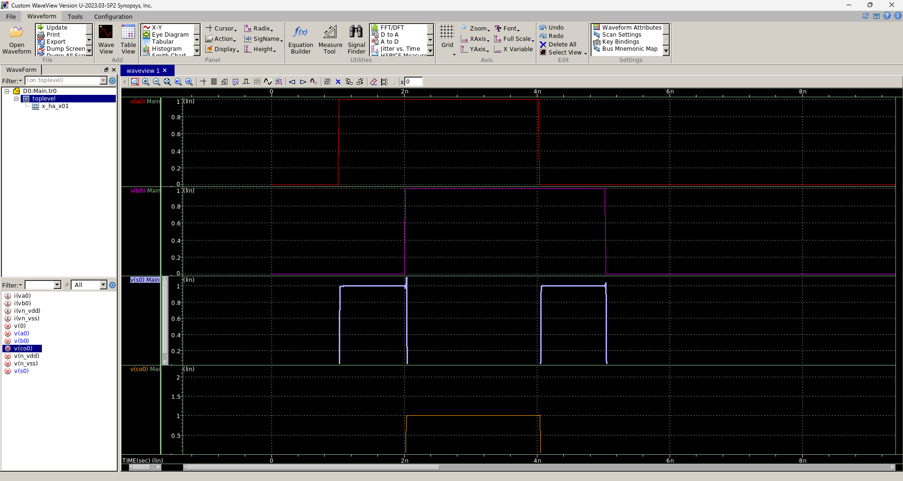
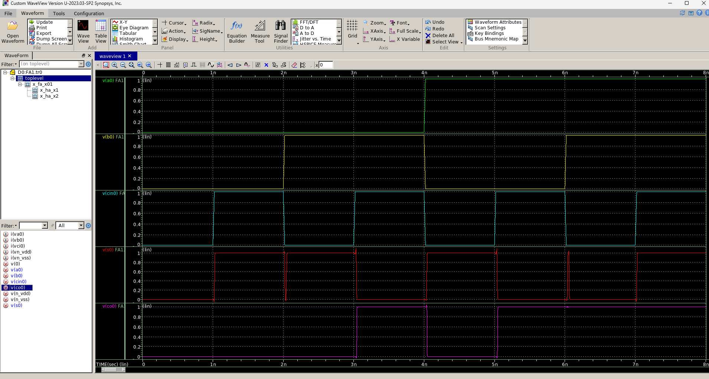
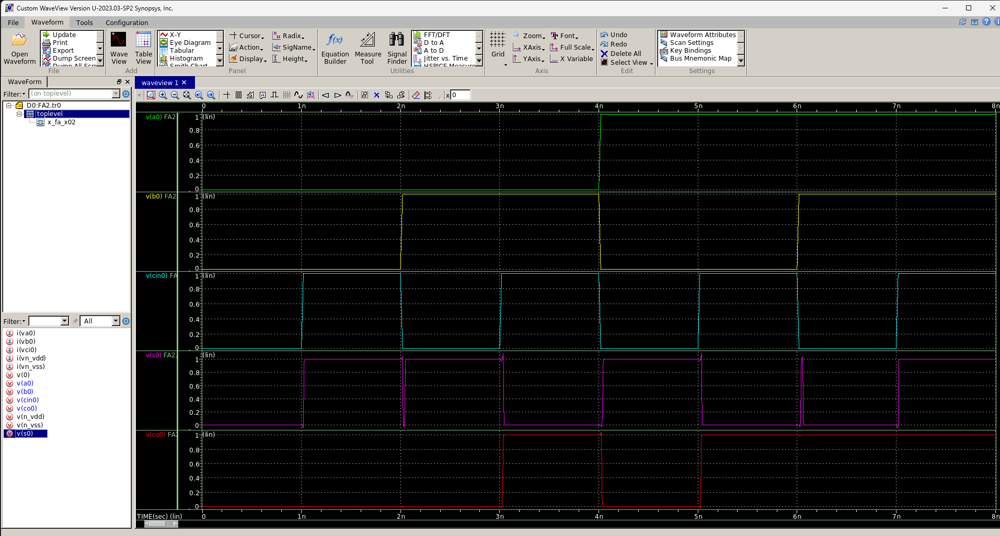
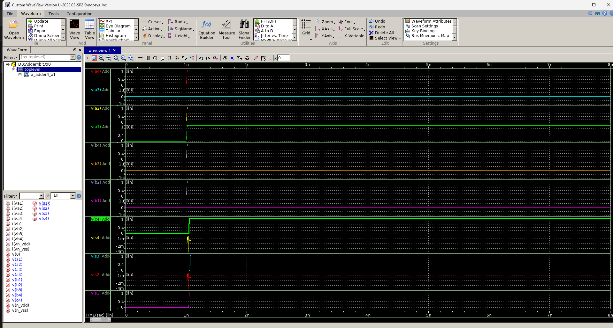
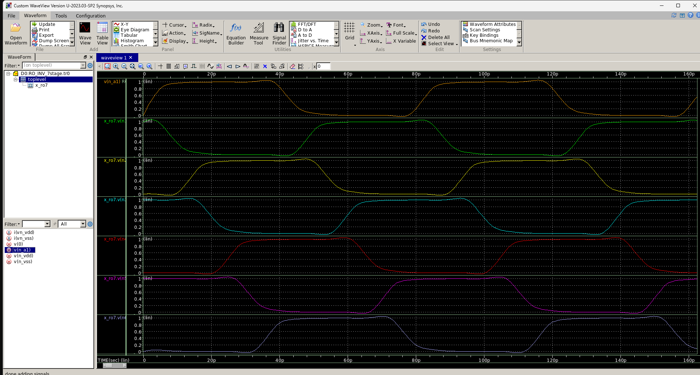

# 45 nm CMOS Adders and Ring Oscillators

A transistor-level HSPICE study of two design choices in 45 nm CMOS. The arithmetic circuits compare a modular full adder with a NAND-only implementation under identical input activity. The oscillator circuits compare inverter, NAND, and NOR feedback loops sized for a 1 ns period. The simulations use the nominal FreePDK45 device models at **1.0 V and 25 °C**.

## Arithmetic circuits

### Half adder

Four NAND gates generate the XOR sum. An inverter reuses the first NAND output to produce the AND carry. The transient stimulus exercises all four input states. `S0` is high when exactly one input is high, and `Co0` is high during the interval when both are high.



### Full-adder comparison

Both versions implement the same sum and carry functions. The first chains two half adders and ORs their carry outputs through a NOR gate and an inverter. The second uses nine NAND gates, sharing intermediate signals from the XOR networks to form the carry output. At the transistor level, that reduces the design from 42 to 36 MOSFETs.

The shared 8 ns testbench steps through all eight combinations of `A0`, `B0`, and `Cin0`. The waveforms show the same settled sum and carry sequence in both implementations. Brief excursions on `S0` around input changes show why the settled values are read between transitions.

**Full adder built from two half adders**



**Nine-NAND full adder**



| Testbench | MOSFETs | Average supply power | Peak supply power |
| --- | ---: | ---: | ---: |
| [Half adder](netlists/half_adder.sp) | 18 | 0.7045 µW | 0.3281 mW |
| [Full adder from two half adders](netlists/full_adder_two_half_adders.sp) | 42 | 8.199 µW | 0.7432 mW |
| [Nine-NAND full adder](netlists/full_adder_nand.sp) | 36 | 7.162 µW | 0.5581 mW |
| [4-bit ripple-carry adder](netlists/ripple_carry_adder_4bit.sp) | 168 | 4.178 µW | 1.105 mW |

The nine-NAND version drew **12.6% less average power** and **24.9% less peak power** under the shared stimulus. Each deck calculates instantaneous supply power as `-V(n_VDD) × I(Vn_VDD)` and uses HSPICE `.MEASURE TRAN` to report its average and maximum. The half-adder and 4-bit rows reflect their own input sequences and measurement windows.

### 4-bit ripple-carry adder

Four instances of the modular full adder form the carry chain, starting with the least-significant carry tied low. The illustrated stimulus applies `1011 + 1010` at approximately 1 ns. Once the signals settle, `C4:S4:S3:S2:S1` reads `10101`, or 21 in decimal. The small excursions on `S4` and `S2` are visible on millivolt-scale axes. Both bits settle low.



## Ring oscillators

The seven-inverter loop establishes a baseline for the delay of a stage in the ring. The three longer loops use odd stage counts and target a 1 ns period. Each NAND stage has one input tied high, and each NOR stage has one input tied low, so both gate types act as inverters in the feedback path.

An initial condition starts the oscillation. HSPICE measures the period between the second and third rising crossings of `VDD/2` at the output. The effective average stage delay is estimated as $T/(2N)$, where $T$ is the measured period and $N$ is the number of stages.

| Testbench | Stages | Measured period | Effective delay per stage |
| --- | ---: | ---: | ---: |
| [Inverter baseline](netlists/ring_inverter_7stage.sp) | 7 | 79.65 ps | 5.69 ps |
| [1 ns inverter loop](netlists/ring_inverter_1ns.sp) | 87 | 989.8 ps | 5.69 ps |
| [1 ns NAND loop](netlists/ring_nand_1ns.sp) | 55 | 998.0 ps | 9.07 ps |
| [1 ns NOR loop](netlists/ring_nor_1ns.sp) | 39 | 992.5 ps | 12.72 ps |

The **55-stage NAND loop** came closest to the target at **998.0 ps**. The NOR loop reached the same range with the fewest stages, consistent with its longer effective stage delay in this configuration.

The seven-stage waveform shows the output and internal nodes over roughly two cycles. The offset between traces shows the transition propagating from one inverter to the next.



## Reproduce the simulations

Use Synopsys PrimeSim HSPICE and the [NC State FreePDK45 base kit](https://eda.ncsu.edu/freepdk/freepdk45/). Set `PDK_DIR` to the directory containing `ncsu_basekit`. The decks load the nominal device models at `ncsu_basekit/models/hspice/hspice_nom.include`.

From the repository root, run the example below in Bash. In tcsh, use `setenv PDK_DIR /path/to/FreePDK45` in place of the first command.

```sh
export PDK_DIR=/path/to/FreePDK45
cd netlists
mkdir -p ../runs
hspice -i full_adder_nand.sp -o ../runs/full_adder_nand
```

Substitute any linked `.sp` deck and give it a matching output prefix. Review the `.mt0` file for measurements, the `.lis` file for the simulation listing, and the `.tr0` file for traces. The figures above were captured in Synopsys Custom WaveView.

## Acknowledgments

The half-adder implementation uses a supplied reference topology. [`cmos_cells.inc`](netlists/cmos_cells.inc) retains the inverter, NAND, and NOR transistor definitions from the supplied `Subcircuits.sp`.
